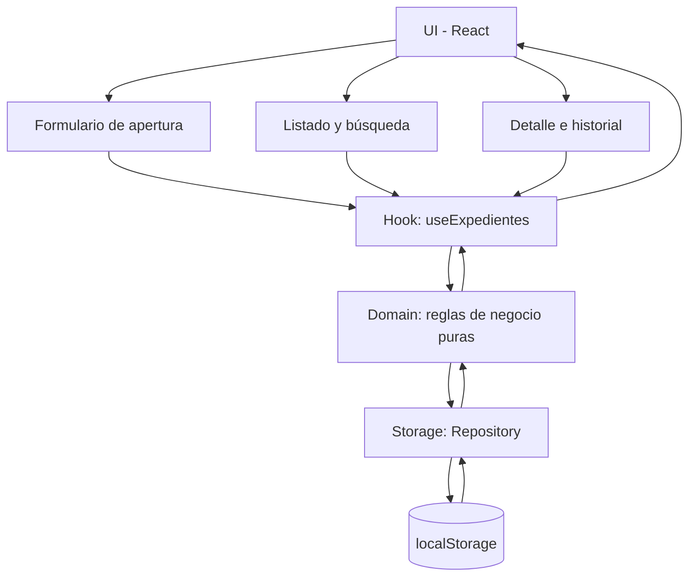

# 1. Análisis y organización del proyecto

## 1.1. Problema, usuario y prioridades

### Problema

El Bufete Popular necesita una herramienta que permita organizar y dar seguimiento a los expedientes de personas solicitantes de asesoría y asistencia jurídica gratuita. Actualmente, el reto consiste en disponer de un mecanismo sencillo para registrar expedientes, consultar su estado, documentar actividades y conservar un historial cronológico de los cambios realizados.

### Usuario objetivo

Personal responsable de gestionar los expedientes del Bufete Popular, encargado de registrar solicitudes, consultar información, documentar actividades y actualizar los estados de los expedientes.

Los datos utilizados durante la competencia serán ficticios y exclusivamente demostrativos.

### Prioridades (MoSCoW)

| Prioridad | Requerimientos |
|---|---|
| **Must Have** | Apertura de expedientes con validación de campos obligatorios, generación automática de identificador, fecha y estado inicial. Consulta, búsqueda por identificador o solicitante, registro de actividades, historial cronológico, transiciones de estado, cierre validado y persistencia mediante localStorage. |
| **Should Have** | Interfaz clara, mensajes de confirmación y error comprensibles, filtro de expedientes por estado y presentación organizada del historial. |
| **Could Have** | Selección de categoría opcional (Civil, Familiar o Laboral) y tipo de actividad opcional. |
| **Won't Have** | Backend, autenticación, base de datos externa, asesoría jurídica, archivos adjuntos, notificaciones, reportes externos y funcionalidades para editar o eliminar expedientes. |

## 1.2. Datos principales, reglas de negocio y supuestos

### Datos principales

La aplicación utilizará las siguientes entidades y estructuras:

- **Expediente:** identificador único (`EXP-0001`), solicitante, asunto, responsable, categoría opcional, estado, fecha de apertura, fecha de cierre, motivo de cierre e historial.
- **EventoHistorial:** identificador, tipo de evento, fecha en formato ISO, descripción, tipo de actividad opcional, estado anterior, estado nuevo y motivo opcional.
- **EstadoExpediente:** Abierto, En seguimiento o Cerrado.
- **Categoria:** Civil, Familiar o Laboral.
- **TipoEvento:** apertura, actividad o cambio_estado.
- **NuevoExpedienteInput:** solicitante, asunto, responsable y categoría opcional.

### Reglas de negocio

| ID | Regla |
|---|---|
| R1 | Los campos solicitante, asunto y responsable son obligatorios y no pueden contener únicamente espacios en blanco. |
| R2 | Cada expediente tendrá un identificador único, secuencial y persistente, con formato `EXP-0001`. |
| R3 | Todo expediente nuevo inicia con estado Abierto y registra automáticamente su fecha y hora de apertura. |
| R4 | La categoría del expediente es opcional y admite Civil, Familiar o Laboral. |
| R5 | Un expediente Abierto únicamente puede pasar a En seguimiento mediante una acción explícita del usuario. |
| R6 | Un expediente solamente puede pasar de En seguimiento a Cerrado cuando tiene al menos una actividad registrada y se proporciona un motivo de cierre no vacío ni compuesto únicamente por espacios. |
| R7 | No se permite pasar directamente de Abierto a Cerrado. |
| R8 | Las actividades requieren una descripción obligatoria y una fecha y hora automáticas. El tipo de actividad es opcional. |
| R9 | Solamente se pueden registrar actividades en expedientes Abiertos o En seguimiento. |
| R10 | Los expedientes Cerrados no permiten nuevas actividades ni cambios de estado. |
| R11 | La apertura y cada cambio de estado deben generar un evento en el historial. Cada actividad también debe conservarse como un evento independiente. |
| R12 | El historial debe presentar los acontecimientos en orden cronológico y distinguir entre apertura, actividades y cambios de estado. |
| R13 | Al cerrar un expediente se conservarán la fecha, hora y motivo de cierre. |
| R14 | Los expedientes y sus historiales deben conservarse al recargar o volver a abrir la aplicación mediante localStorage. |
| R15 | Los expedientes Cerrados permanecen disponibles para consulta. |

### Supuestos

- Los nombres de solicitantes y responsables serán ficticios o alias; no se almacenará información personal real.
- Cada expediente representa un registro independiente dentro del almacenamiento local del navegador.
- El identificador secuencial se generará considerando los expedientes previamente almacenados para evitar duplicaciones después de recargar.
- Las fechas y horas se generarán automáticamente desde el entorno del navegador y se conservarán en formato ISO.
- El almacenamiento se limita al navegador y dispositivo donde se utiliza la aplicación; no existe sincronización entre dispositivos.
- La aplicación es un prototipo académico y no sustituye procedimientos oficiales ni proporciona asesoría jurídica.

## 1.3. Responsabilidades del equipo

| Integrante | Responsabilidad | Entregables principales |
|---|---|---|
| **1. Tech Lead / Integración** | Definir y mantener el contrato técnico, coordinar el desarrollo y resolver conflictos de integración. | `src/types/expediente.ts`, `src/App.tsx`, revisión de contratos y merges. |
| **2. Dominio y persistencia** | Implementar las reglas de negocio, operaciones de expedientes y almacenamiento local. | Dominio, Repository sobre localStorage y `src/hooks/useExpedientes.ts`. |
| **3. UI de apertura y listado** | Desarrollar los formularios de apertura, listado y búsqueda de expedientes. | `src/features/apertura/FormularioApertura.tsx` y `src/features/listado/ListadoExpedientes.tsx`. |
| **4. UI de detalle, historial y estados** | Implementar la visualización del expediente, registro de actividades, historial y acciones de cambio de estado. | `src/features/detalle/DetalleExpediente.tsx`. |
| **5. QA, README y demostración** | Verificar los recorridos funcionales, documentar resultados, registrar decisiones de IA y preparar la demostración. | Pruebas manuales, comprobaciones del README y datos ficticios para la demo. |

### Estrategia de integración con Git

Se utilizará una estrategia de ramas independientes para facilitar el trabajo simultáneo y reducir conflictos.

- Cada integrante desarrollará su aporte en una rama `feat/*`.
- La rama `main` conservará la versión integrada y funcional del proyecto.
- El Tech Lead revisará los cambios y verificará que respeten las interfaces, nombres, rutas y firmas acordadas.
- Se realizarán dos hitos principales de integración:
  - **Minuto 50:** primer merge a `main` para integrar los módulos principales y comprobar su compatibilidad.
  - **Minuto 70:** segundo merge a `main` para incorporar correcciones, completar funcionalidades y resolver conflictos.
- El tiempo restante se reservará para pruebas integrales, correcciones finales, actualización del README y commit de entrega.

## 1.4. Arquitectura propuesta

Se utilizará una arquitectura por capas para separar la interfaz, la lógica de aplicación, las reglas de negocio y la persistencia.

**Descripción de las capas:**

1. **UI (features):** contiene los componentes visuales de apertura, listado y detalle. Recibe propiedades y comunica las acciones del usuario.
2. **Hook (useExpedientes):** centraliza las operaciones de expedientes, administra el estado de la aplicación y conecta la interfaz con el dominio.
3. **Domain:** contiene las reglas de negocio y validaciones independientes de la interfaz y del almacenamiento.
4. **Storage (Repository):** administra la lectura y escritura de expedientes e historiales en localStorage, conservando la información entre recargas.

La arquitectura mantiene separadas las responsabilidades y permite integrar los aportes de los cinco integrantes respetando el contrato compartido.

## 2. Decisiones y uso razonado de la IA

| Decisión o necesidad | Aporte de la IA | Decisión del equipo y razón | Cómo se comprobó |
|---|---|---|---|
| **Identificador `EXP-0001` único aunque se recargue** | Propuso dos alternativas: (A) contador persistente en localStorage; (B) calcular el máximo de los ids existentes + 1. | Se aceptó A, combinada con B como respaldo: contador y expedientes se guardan en **un solo objeto JSON** (no se desincronizan) y al leer se usa `max(contador, mayor id)`. Así nunca se reutiliza un número, aunque se manipulen o vacíen los datos. Se descartó B sola porque reutiliza números si se elimina el último. | Crear dos expedientes, recargar y crear un tercero → `EXP-0003`. Pruebas del repository con JSON vacío, JSON corrupto (se respalda en `bufete-expedientes-v1-corrupto`) y localStorage no disponible. |
| **Parte 2: Reabrir expediente (Cerrado → En seguimiento)** | Analizó el impacto: la regla original prohibía cualquier cambio en un Cerrado y el modelo solo tiene un `fechaCierre`/`motivoCierre`. Propuso (A) agregar un arreglo de cierres al tipo, o (B) usar el historial como fuente de verdad de todos los cierres. | Se eligió B para **no romper el contrato compartido** (`types/expediente.ts`): cada cierre y reapertura es un evento `cambio_estado` con fecha, motivo, `estadoAnterior` y `estadoNuevo`, y nunca se borra. `fechaCierre`/`motivoCierre` describen solo el cierre vigente. La regla vive en el dominio (`reabrirExpediente`): rechaza motivos vacíos o solo espacios y cualquier estado distinto de Cerrado, aunque la interfaz oculte el botón. El nuevo cierre usa las mismas condiciones originales. La prop `onReabrir` es opcional para no romper el contrato del componente. | Pruebas del dominio: reabrir desde Abierto y En seguimiento → rechazado; motivo `"   "` → rechazado; reabrir, agregar actividad y cerrar de nuevo → 2 cierres en el historial. Prueba en navegador del recorrido 4 completo con recarga intermedia. |

## 3. Registro de resultados

Además de las pruebas manuales, el recorrido se ejecutó automáticamente en un navegador (Chromium) sin errores en la consola.

| Recorrido | Comprobación esperada | Resultado observado | Estado |
|---|---|---|---|
| 1. Apertura | Crear dos expedientes con identificadores distintos; rechazar campos obligatorios incompletos. | Con el formulario vacío se muestran los 3 errores. Se crean `EXP-0001` y `EXP-0002` con datos recortados (trim), estado Abierto y fecha automática. | Cumple |
| 2. Consulta | Localizar por identificador y persona, abrir detalle e historial e informar una búsqueda sin resultados. | La búsqueda "jose" encuentra "José Pérez" (sin distinguir mayúsculas ni acentos). Abre el detalle con el historial cronológico. Una búsqueda sin coincidencias muestra "No se encontraron expedientes". | Cumple |
| 3. Seguimiento y cierre | Agregar actividades, pasar a En seguimiento y cerrar con actividad previa y motivo. Rechazar cierres inválidos y bloquear actividades mientras esté cerrado. | Cerrar desde Abierto o sin actividad está bloqueado. El motivo `"   "` se rechaza. Al cerrar se guardan fecha y motivo, y el formulario de actividades desaparece. Los datos persisten al recargar. | Cumple |
| 4. Reapertura y trazabilidad | Rechazar motivos vacíos y reaperturas en estados incorrectos. Reabrir válidamente, agregar una actividad y cerrar de nuevo. Conservar actividades y ambos cierres con sus fechas y motivos, incluso después de recargar la aplicación. | El botón Reabrir solo aparece en Cerrado y el dominio rechaza reabrir en Abierto o En seguimiento. El motivo `"   "` se rechaza. Al reabrir pasa a En seguimiento, se agrega otra actividad y se cierra de nuevo. Tras recargar se conservan las 2 actividades, los 2 cierres ("Cierre uno" y "Cierre dos") y la reapertura, cada uno con su fecha y motivo. | Cumple |

### Limitaciones conocidas

- Los datos viven solo en el navegador y dispositivo donde se usan (localStorage); no hay sincronización.
- Si se borra el almacenamiento del navegador, se pierden los expedientes y la numeración vuelve a `EXP-0001`.
- Con dos pestañas creando expedientes exactamente al mismo tiempo podría repetirse un id (se mitiga recargando los datos cuando otra pestaña los cambia).
- No hay edición ni eliminación de expedientes (fuera del alcance definido).

